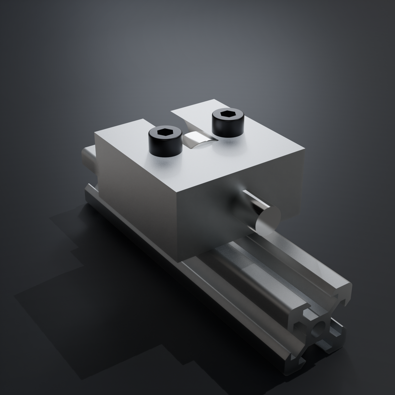
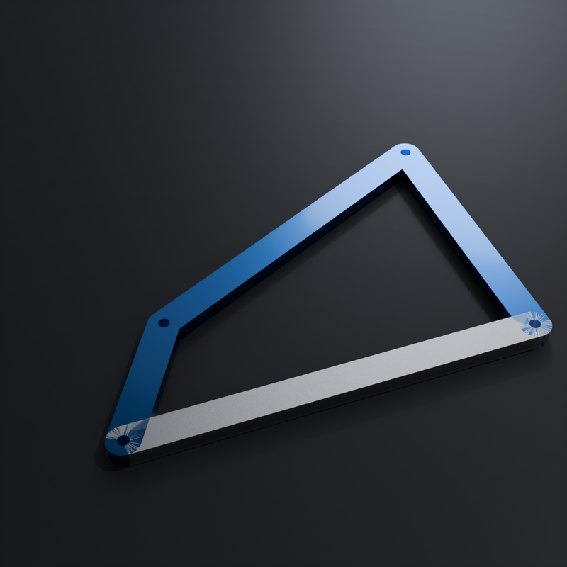
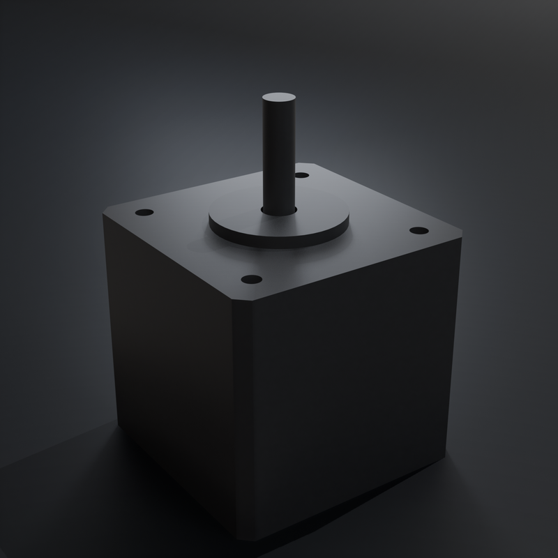
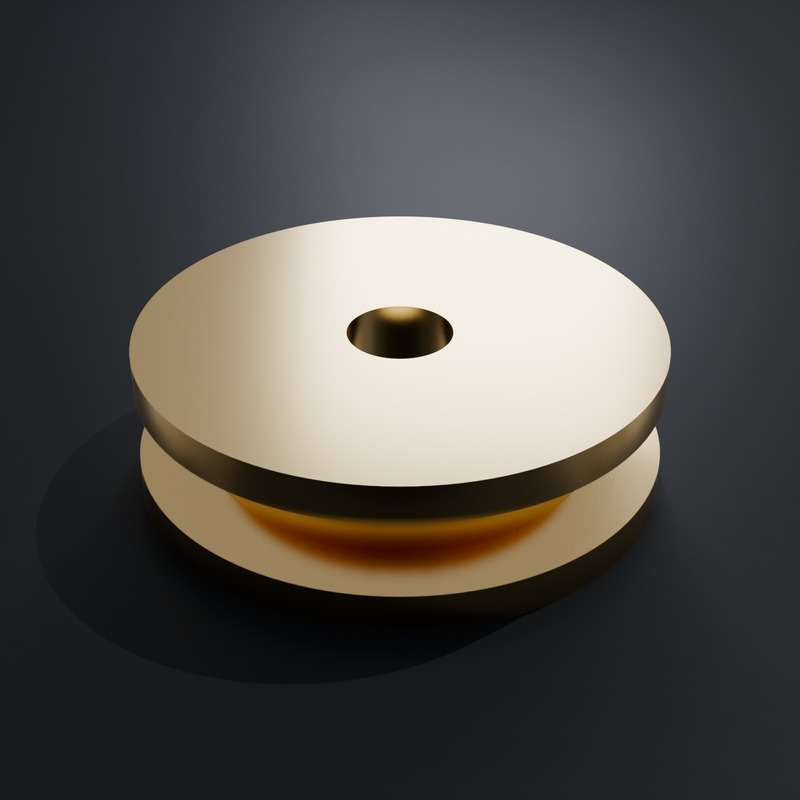
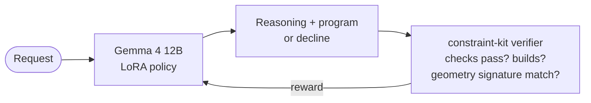
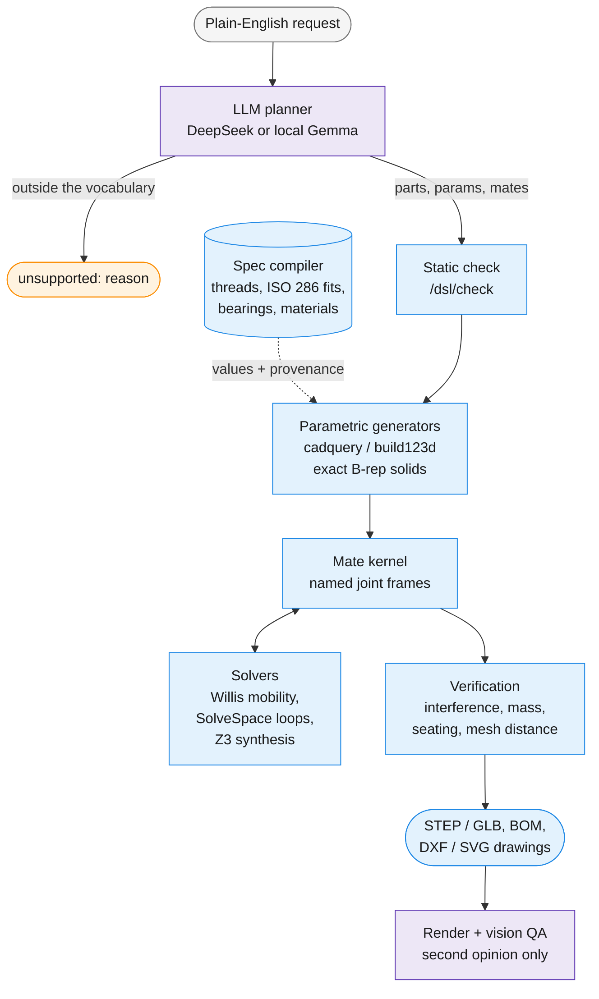

# constraint-kit

**Describe a mechanism in plain English. Get exact, manufacturable CAD back: STEP files, real B-rep geometry,
not a mesh an AI guessed at.**


```text
"a plate with a spacer and a 24-tooth gear stacked on its boss"
```
→ e.g. a 100×100 mm aluminum plate with a 4-bolt circle, a spacer on the boss, and a module-2 24-tooth steel spur
gear seated on the spacer with **zero gap** (a real run; the planner picks sensible values). Out come STEP + GLB, mass properties, a BOM, and a render.

## Why it's different

Most text-to-CAD asks a model to produce geometry, then hopes. constraint-kit splits the job:

> **The AI handles meaning. Deterministic math handles geometry.** The LLM only decides *which* parts, *which*
> parameters, and *what connects to what*. Parametric generators build exact B-rep solids, and a
> deterministic mate kernel puts every part in place. The model never places a single vertex.

So the results can be **checked**, not just looked at:

- **Gears actually mesh.** Center distances come from module × teeth, not from eyeballing.
- **Parts actually seat.** Mates are solved against named joint frames that survive parameter changes.
- **Collisions are caught.** A bounding-box prefilter is followed by an exact OpenCascade boolean clash check.
- **Mechanisms are solved properly.** Planetary mobility uses Willis' equation, linkages use SolveSpace, and
  gear-train and tolerance synthesis use a Z3 SMT solver.

### It says "no" instead of guessing

Ask for something outside its vocabulary and it declines, and says why:

```text
"Need a spiral bevel gear for a heavy-duty application."
→ {"unsupported": "only straight bevel gears are modeled"}
```

A plausible-looking wrong part is worse than no part. Honest declines are a first-class, measured output, not
an error path.

### And it checks whether the part will hold

Exact geometry tells you the parts fit. It does not tell you the bracket is stiff enough. So there is a
physics tier — linear elastostatics on a voxel grid, **numpy and scipy only**, no solver to install and no
meshing step that can fail mid-loop:

```bash
python drivers/fea_part.py PART.stl --material petg --pitch 1.3 --converge \
    --fix "x>=-36 & x<=-32 & y>=143 & y<=183" \
    --fix "x>=24@xz" \
    --load "x<=-46 & y>=183 : 0,764,0"
```

Boundary conditions are arguments, never inferred — choosing where a part is held and where it is pushed
*is* the engineering, and a tool that guesses produces something that looks like analysis and is not.

It is verified against ground truth that exists outside this repo: a free element has exactly six
rigid-body modes, a uniform strain field is reproduced exactly, axial extension matches `PL/AE` and stress
matches `P/A` to 1e-9, and a cantilever reaches 95.7 / 97.7 / 98.5 % of Timoshenko at 4 / 6 / 8 elements
through the thickness. The voxeliser agrees with exact mesh volume to within ±1.2 % across 20 real printed
parts.

**And it declines here too.** A single voxel-FEA number is not a result, so `--converge` solves a geometric
ladder and Richardson-extrapolates — and when the sequence is not actually converging it says so instead of
fitting a confident number to noise:

```text
deflection  mm  not converging: successive changes are growing, not shrinking (0.309 then 0.376);
                refinement is still finding structure rather than resolving it
```

That is a real run. It means a load-carrying wall is only a few elements thick, so a finer grid is the wrong
answer and a body-fitted mesh is the right one. Knowing that is worth more than a number.

## Gallery

| | | |
|:-:|:-:|:-:|
|  |  |  |
| *"a pillow bearing block bolted to the side of a 100 mm 20x20 aluminum V-slot extrusion with two M5 socket head screws, a 608 ball bearing pressed into the block's bore, and a 60 mm long 8 mm steel shaft through the bearing"* | *"an M8 threaded rod 80 mm long with a steel washer and hex nut near each end"*. The thread is real helical geometry | Four-bar linkage from link lengths 100 / 35 / 90 / 70 mm, closed by the SolveSpace solver |
|  |  |  |
| NEMA stepper, placed as a BOSL2 library "vitamin" | Flanged pulley, added after the census found it among the most-requested missing parts | Spur pair at the exact center distance, *m·(z₁+z₂)/2* |

Every image on this page is a real constraint-kit build, rendered in Blender straight from the exported GLB.
The geometry is untouched; only materials and lighting were added. Quoted captions are the exact sentences
that were typed in: the planner (DeepSeek, the default backend) wrote the program, and constraint-kit built
it. The Z3 planetary in the banner was designed by the SMT solver to exactly 4:1. The banner's three-gear
train had its mesh angles set by hand so the train folds onto the plate.

## A local model that knows when to decline

[**gemma-4-12b-constraintkit**](https://huggingface.co/jajmangold/gemma-4-12b-constraintkit-GGUF) is a Gemma 4 12B fine-tune (SFT + GRPO with the geometry verifier as
the reward) that writes constraint-kit programs directly from plain English, on one local GPU:

| | Builds (geometry-verified) | Honest declines |
|---|:-:|:-:|
| SFT, held-out probes | **93%** | **87%** |
| + GRPO | builds held at 6/6 | 9/10 (silent wrong builds halved) |



No reward model and no LLM judge. The reward is whether the CAD actually checks out.

It performs in the same range as a prompted frontier model, shows its reasoning, and runs as a 9.8 GB GGUF.
It's optional: constraint-kit runs on a hosted LLM out of the box. Training scripts are in [`training/`](training/).

## Features

- **Natural language → CAD**: describe an assembly in plain English, get exact STEP/GLB output
- **Four solver classes**: deterministic tree mates, analytical gear mobility (Willis), geometric loops (SolveSpace), discrete synthesis (Z3/SMT)
- **Real engineering parts**: gears, extrusions, bearings, fasteners, plumbing via build123d/bd_warehouse
- **First-class oriented joints**: named mate frames that survive parameter changes (no selector drift)
- **Spec compiler**: on-demand engineering-fact resolution with provenance (threads, ISO 286 fits, bearings, materials)
- **Hierarchical assemblies**: recursive subassemblies with ports, BOM roll-ups, mass properties
- **Top-down design**: requirements → derived parameters → geometry, with incremental re-solve
- **Engineering drawings**: 2D drawing sets (DXF + SVG), exploded views, 2D layouts → DXF for laser/CNC
- **Structural physics**: stiffness and stress on real geometry, numpy/scipy only — no solver install
- **148 regression tests**, every one checked against geometry or closed-form physics, never against a vision model's opinion

## Quick start

The planner and vision QA default to [DeepSeek's API](https://api-docs.deepseek.com/), so you need a key:

```bash
export DEEPSEEK_API_KEY=sk-...
```

### With Docker (recommended)

```bash
docker compose -f cadkit/docker-compose.yaml up -d --build
curl -s http://127.0.0.1:8195/health
```

### Without Docker

```bash
pip install -e ".[all]"
uvicorn constraint_kit.api:app --host 127.0.0.1 --port 8195
```

### First assembly

```python
import httpx

r = httpx.post("http://127.0.0.1:8195/build", json={
    "request": "a plate with a spacer and a 24-tooth gear stacked on its boss"
})
print(r.json())
```

Or via the CLI:

```bash
curl -X POST http://127.0.0.1:8195/build \
  -H "Content-Type: application/json" \
  -d '{"request": "a plate with a spacer and a 24-tooth gear stacked on its boss"}'
```

## Environment variables

| Variable | Default | Description |
|---|---|---|
| `DEEPSEEK_API_KEY` | — | **Required** for the default DeepSeek backend (`LLM_API_KEY` also works) |
| `LLM_BASE_URL` | `https://api.deepseek.com` | OpenAI-compatible LLM endpoint for planning + vision QA. Set to a local vLLM / llama.cpp URL (e.g. `http://localhost:8000/v1`) to self-host |
| `MODEL_PLANNER` | `deepseek-v4-pro` | Model that turns requests into assembly specs |
| `MODEL_VLM` | `deepseek-flash` | Vision model for render QA and table extraction (must accept images) |
| `PLANNER_URL` / `VLM_URL` | `LLM_BASE_URL` | Optional per-role endpoint overrides |
| `SPEC_SEARCH_URL` | `http://localhost:8080` | SearXNG instance for spec compiler discovery |
| `CK_WORK_DIR` | `/tmp/constraint-kit` | Working directory for outputs and caches |
| `NEO4J_PASS` | `changeme` | Neo4j password (optional, for atlas persistence) |
| `BLENDER_IMAGE` | `blender:latest` | Docker image for GLB rendering |
| `SPEC_DB_PATH` | `<work_dir>/spec_store.sqlite` | SQLite path for spec compiler cache |
| `SPEC_CACHE_DIR` | `<work_dir>/spec_cache` | JSON artifact dump for spec resolutions |

## Architecture



Purple is where the AI makes a judgment. Blue is deterministic and reproducible: the same program gives the
same geometry every time. Vision QA can flag a render, but it never overrides the geometric checks.

**Doctrine**: AI for semantics, deterministic geometry for placement. The LLM proposes; exact geometry + the mate kernel dispose.

## API

All endpoints on `127.0.0.1:8195` (host-only by default).

### Core

| Method | Endpoint | Description |
|---|---|---|
| `GET` | `/health` | Health check + atlas status |
| `POST` | `/plan` | LLM spec only (no build) |
| `POST` | `/build` | Plan + assemble in one shot |
| `POST` | `/assemble` | Build from a spec |
| `POST` | `/qa` | Attach render + verdict to a stored assembly |

### 2D Layout

| Method | Endpoint | Description |
|---|---|---|
| `POST` | `/layout2d` | Plan/solve a 2D layout → DXF + PNG |
| `POST` | `/layout_qa` | Attach a layout verdict |

### DOF Solvers

| Method | Endpoint | Description |
|---|---|---|
| `POST` | `/dof/planetary` | Gear-loop mobility (Willis) |
| `POST` | `/dof/four_bar` | 4-bar linkage (SolveSpace) |
| `POST` | `/dof/slider_crank` | Slider-crank (SolveSpace) |
| `POST` | `/mechanism/four_bar` | Pose a 4-bar as an assembly |

### Design

| Method | Endpoint | Description |
|---|---|---|
| `POST` | `/design` | Top-down parametric design |
| `POST` | `/design/reedit` | Incremental re-solve (changed requirements) |
| `POST` | `/assembly/tree` | Hierarchical assembly with subassemblies |
| `POST` | `/assembly/bom` | Bill of Materials (md/csv) |
| `POST` | `/assembly/interference` | Clash detection |
| `POST` | `/assembly/explode` | Exploded view |
| `POST` | `/assembly/drawing` | 2D drawing set (DXF + SVG) |

### Intent & DSL

| Method | Endpoint | Description |
|---|---|---|
| `POST` | `/intent/design` | NL → intent → build |
| `POST` | `/intent/resolve` | Resolve intent → canonical form |
| `POST` | `/dsl/check` | Static validation of a DSL program |
| `POST` | `/dsl/verify` | Geometric equivalence check |

### Synthesis

| Method | Endpoint | Description |
|---|---|---|
| `POST` | `/synthesize/planetary` | SMT gear-train synthesis to a ratio spec |
| `POST` | `/synthesize/tolerance` | SMT tolerance allocation |
| `POST` | `/synthesize/gear_train` | Multi-stage gear synthesis |

### Spec Compiler

| Method | Endpoint | Description |
|---|---|---|
| `POST` | `/spec/resolve` | Resolve an engineering fact |
| `POST` | `/spec/validate` | Schema-check a fact |
| `POST` | `/spec/search` | Debug SearXNG discovery |
| `GET` | `/spec/cache` | Recent SQLite resolutions |

### Design Rules

| Method | Endpoint | Description |
|---|---|---|
| `POST` | `/rules/fastener_engagement` | Engagement check |
| `POST` | `/rules/fit` | Fit check |
| `POST` | `/rules/clearance` | Min-gap check |
| `POST` | `/rules/beam_bending` | Cantilever stress/deflection |
| `POST` | `/rules/bolt_preload` | Bolt proof load + preload |

## Part vocabulary

**Native parts** (`parts.py`): `plate`, `spur_gear`, `ring_gear`, `planetary_gearset`, `spacer`, `shaft`, `bolt`, `nut`, `washer`, `bearing`, `threaded_rod`, `link`, `adapter`, `housing`, `sheet_bracket`, `panel`, `four_bar`

**Catalog parts** (`parts_bd.py`): `extrusion` (V-slot 2020/2040), `ball_bearing`, `screw` (ISO), `bearing_block`, `sprocket`, `flange`, `pipe`

**Mates**: `coincident`, `rigid`, `contact`, `mesh`, `revolute`, `cylindrical`

## Running tests

```bash
tools/ci.sh                        # every tier available here; exit 0 = green
CK_GUI=1  tools/ci.sh              # ...plus a real FreeCAD window (~30 s)
CK_LIVE=1 tools/ci.sh              # ...plus the configured model endpoint (costs money)
```

**259 tests in six tiers, each gated on a different dependency**, plus 113 more in the container:

| tier | needs | covers | gating |
|---|---|---|---|
| host | numpy + scipy | physics (23), convergence (16), load cases (16), printed parts (15), workbench core (32) | always |
| cross-check | + `gmsh` and `ccx` | the voxel tier against an independent solver (13) | if found |
| freecad | `freecadcmd` | geometry (30), document (16), commands (33), planner (15), STEP import (14), motion (17), agent end-to-end (4) | if found |
| gui | a real FreeCAD window | toolbar, three panels, the worker threads (17) | `CK_GUI=1` |
| live | a model endpoint | plain English → validated program → built geometry (4) | `CK_LIVE=1` |
| container | `docker exec cadkit` | the cadquery kernel (113) | if up |

The split is deliberate rather than accidental. The kernel suite needs `build123d`, `bd_warehouse`,
`cq_gears`, `z3`, `python_solvespace` and `trimesh`; on a bare host it reports 86/113 with the rest
failing on imports, which is expected rather than a regression. The gui tier exists because two
defects shipped in one day while the Qt layer had no coverage, both invisible to 150 passing headless
tests. The live tier exists because every other planner test injects the model call — which is right,
since a suite that needs a paid API to tell you your parser works is a bad suite — but injection
cannot answer whether a real model, given the real catalogue, produces a program this kernel accepts.
`tools/ci.sh` reports any tier it could not run as **SKIPPED**, never as passed.

Every test is checked against ground truth that exists independently of this code — seating zero-gap, gear
center distances `m·(z₁+z₂)/2`, mass vs density, DXF validity, atlas round-trip, and for the physics tier
element algebra and closed-form elasticity. Never against a stored snapshot of our own output, and never
against a vision model's opinion.

## Project structure

```
constraint_kit/        # the Python package
  parts.py             # native 3D parametric generators
  parts_bd.py          # build123d/bd_warehouse catalog parts
  parts2d.py           # 2D footprint generators
  joints.py            # oriented mate frames
  mate_intent.py       # semantic intent → concrete frames
  mates.py             # deterministic mate kernel
  layout.py            # 2D layout solver + DXF export
  builder.py           # leaf assembly builder
  assembly.py          # hierarchical assemblies + BOM
  parameters.py        # top-down parametric design
  synthesis.py         # SMT design synthesis (Z3)
  spec_compiler.py     # engineering-fact resolution
  validate.py          # interference / clash detection
  fea/                 # physics tier — numpy + scipy only, no CAD dependency
    hex8.py            #   trilinear hex element, stiffness by Gauss quadrature
    voxel.py           #   grid, assembly, solve, von Mises
    sample.py          #   triangle soup → occupancy by ray parity; STL reader
    convergence.py     #   Richardson extrapolation, with an honest refusal path
  api.py               # FastAPI server
  ...
cadkit/                # Dockerfile + docker-compose
drivers/               # orchestration scripts + fea_part.py
tests/                 # regression suites (kernel, physics, convergence)
training/              # Gemma 4 fine-tuning
tools/                 # utilities + ci.sh
libraries/             # reusable assembly defs
```

## The FreeCAD workbench

```bash
python workbench/install.py     # links into FreeCAD's Mod directory; edit in place
```

Describe a part, review the program, build it — in a 3D viewport you can already use, with a
model tree, undo, measurement and an expression engine that came for free. Built on **FreeCAD's
own `Part` kernel**, not cadquery: FreeCAD 1.0 bundles OCCT 7.8.1 and this stack runs OCP 7.9.3,
and two OCCT builds cannot share a process. One process, millisecond rebuilds, fully headless.

**Eight toolbar buttons, and that is the whole toolbar.** Describe · Insert · Join · Requirements
· Check · Analyse · Export · Settings. The rest of the vocabulary lives in the command palette
and tree context menus, because a workbench with forty buttons in six half-empty groups is worse
than one with eight that always mean something.

**Parameters are properties, and provenance rides on the property group.** A value the planner
guessed lands in a group called *Guessed for you*; one you chose lands in *You specified*; one
from a standard carries its ISO clause and the date it was resolved. FreeCAD's own property
editor becomes the provenance inspector, with no custom widget — and the panel header reads
`4 of 11 guessed`, so a guess can never pass for a decision.

**The `.FCStd` is a cache. `<Document>.params.json` is the source of truth** — text, diffable,
and what belongs in git. That discipline is what keeps a parametric project from decaying into a
pile of one-way edits to a binary document.

**Checks are a dock, not a modal, and `stale` is a first-class state.** Change the model and a
green verdict goes grey rather than staying green. A stored result carries a fingerprint of the
geometry it was computed against, so it cannot outlive the edit that invalidated it.

### Agents drive it through the same commands you do

```bash
claude mcp add freecad -- python workbench/mcp_bridge.py
```

Everything the interface does is a registered command; the toolbar calls `registry.call(...)` and
so does the MCP server. There is no button that reaches past the registry, which is what stops the
human and agent interfaces from drifting apart — and it is enforced by a test, not by discipline.
Agents get the same observability a human has, including `get_params` with provenance and
`get_checks` with staleness. Discovery is via `~/.ck/instances/<pid>.json`; **no fixed port is
ever assumed.**

## Documentation

| file | what it is |
|---|---|
| [`PLAN.md`](PLAN.md) | **the active plan** — phases, research grounding, and what we deliberately will not build |
| [`CLAUDE.md`](CLAUDE.md) | architecture reference: layout, API, solver classes, gotchas |
| [`AGENTS.md`](AGENTS.md) | how to work in this repo — TDD protocol, conventions, traps that have cost time |
| [`CHANGELOG.md`](CHANGELOG.md) | what changed and **why**; decisions, not just code |
| [`ROADMAP.md`](ROADMAP.md) | the original screw → car → home thesis. `PLAN.md` supersedes it on ordering |
| [`BACKLOG.md`](BACKLOG.md) | epic list. Live work is tracked in [issues](../../issues), milestoned by phase |

## License

MIT
